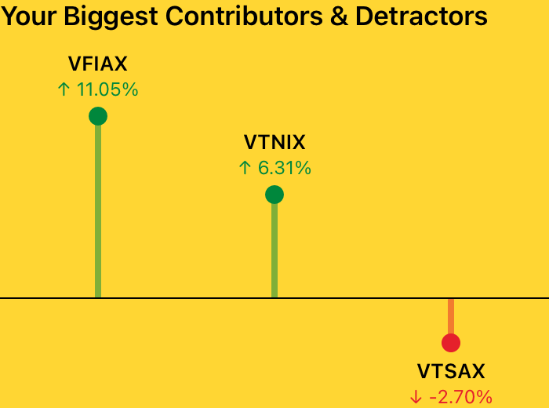
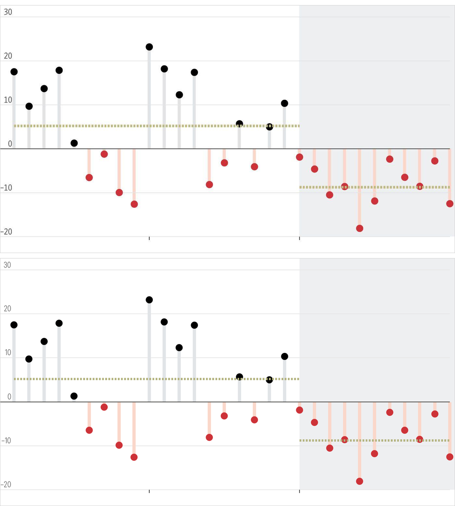
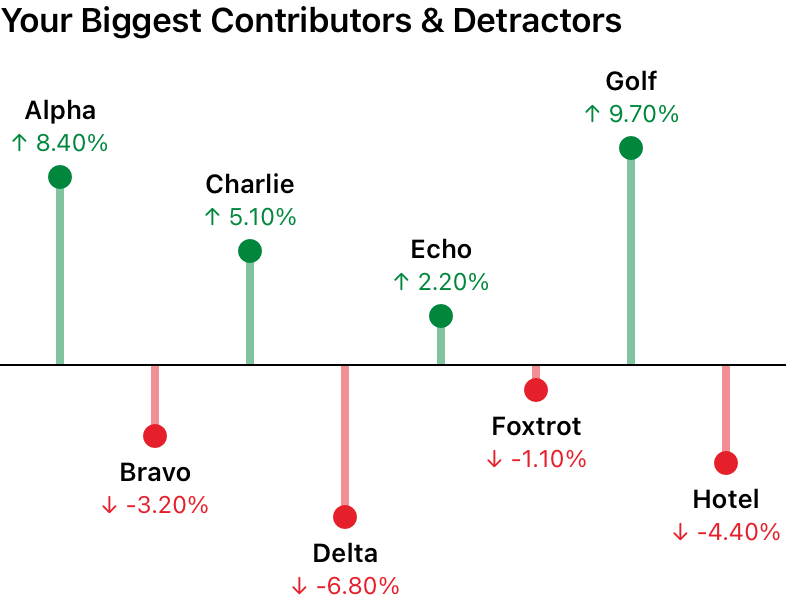
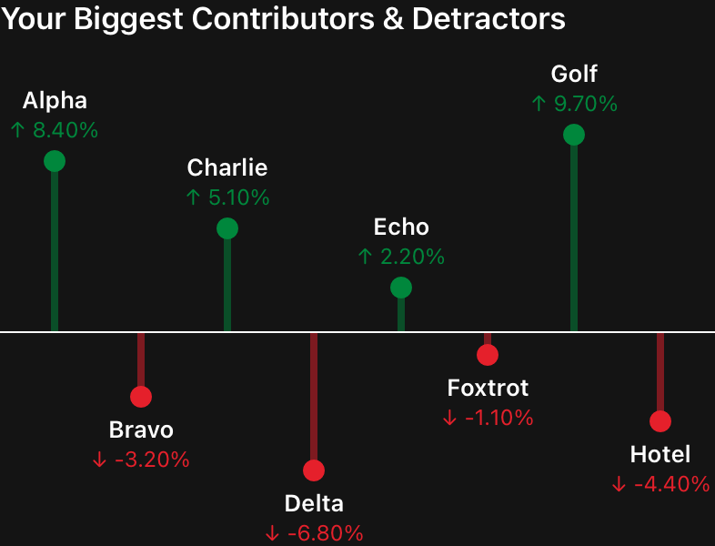
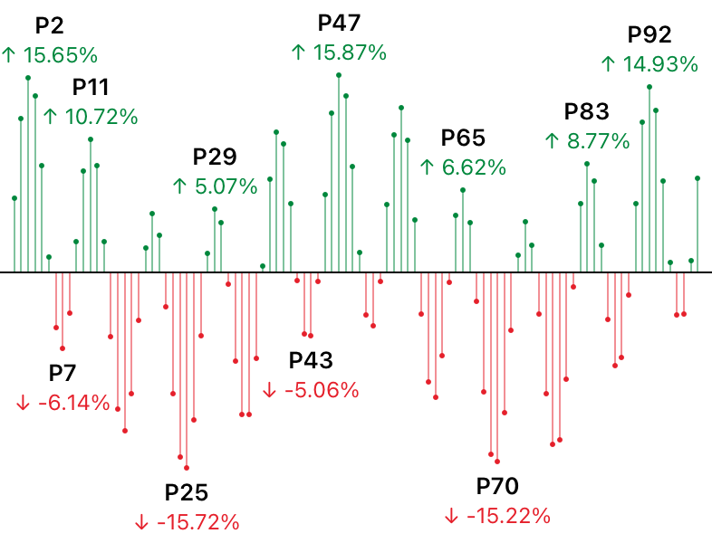
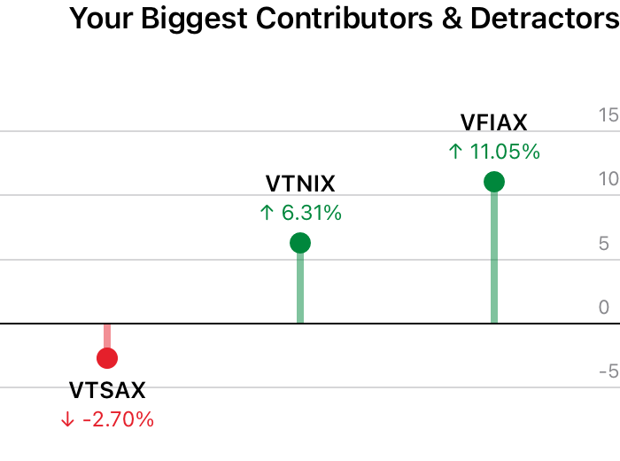
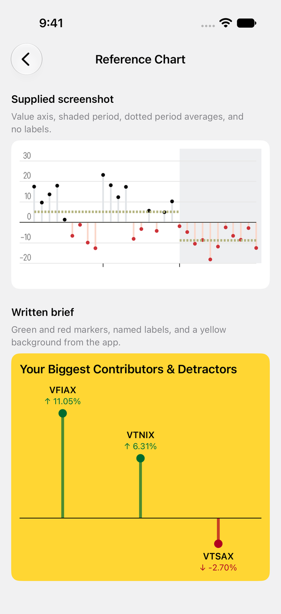
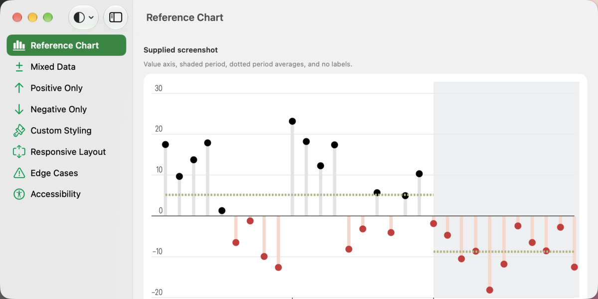

# ContributionChart

A SwiftUI chart that shows which values lifted a total and which pulled it down, around a zero baseline.
It adapts to any frame, works with VoiceOver, and has no dependencies.



```swift
import ContributionChart
import SwiftUI

struct PortfolioView: View {
    private let data: [ChartDataPoint] = [
        .init(title: "VFIAX", value: 11.05),
        .init(title: "VTNIX", value: 6.31),
        .init(title: "VTSAX", value: -2.70)
    ]

    var body: some View {
        ContributionChart(points: data, title: "Your Biggest Contributors & Detractors")
            .frame(height: 260)
    }
}
```

## Features

- **Fits any frame.** Works in a `VStack`, `HStack`, `ScrollView`, `List`, `Grid`, sheet, or resizable
  window. The parent decides the size and the chart adapts, dropping labels before anything else when space
  is tight.
- **Honest scaling.** One linear scale, so equal magnitudes are equally long on both sides of the baseline.
  Choose proportional, symmetric, or fixed.
- **Readable at any density.** Marks shrink as points get closer. The largest values keep their labels, and
  labels never overlap.
- **Accessible.** VoiceOver hears a summary and each value with its direction in words. Includes Audio Graph
  support, Dynamic Type, right-to-left layout, and contrast-checked default colours.
- **Handles bad input.** `NaN`, infinities, extreme values, and invalid configuration never produce invalid
  geometry.
- **Customizable.** Colours, fonts, sizes, formatting, an optional title, baseline, markers, stems, labels,
  value axis, reference lines, shaded regions, and empty state.
- **No dependencies.** Swift 6 with strict concurrency.

## Requirements

| Platform | Minimum |
|---|---|
| iOS, iPadOS, Mac Catalyst | 16 |
| macOS | 13 |
| tvOS | 16 |
| watchOS | 9 |
| visionOS | 1 |

Requires Swift 6 tools (Xcode 16 or later). See [Platform Support](Documentation/PlatformSupport.md) for
what has been tested on each.

## Installation

In Xcode, choose **File > Add Package Dependencies**, enter this URL, and add the `ContributionChart` library
to your target:

```text
https://github.com/tahirwaseempk90/ContributionChartKit
```

Or add it to `Package.swift`. The repository is named `ContributionChartKit`, while the library and module are
named `ContributionChart`, so both names appear:

```swift
dependencies: [
    .package(url: "https://github.com/tahirwaseempk90/ContributionChartKit.git", from: "1.0.0")
],
targets: [
    .target(
        name: "MyFeature",
        dependencies: [.product(name: "ContributionChart", package: "ContributionChartKit")]
    )
]
```

Then `import ContributionChart`. See [Integration](Documentation/Integration.md) for local packages and versioning.

## Basic usage

Give the chart its data and let the parent set its frame. Everything else is optional:

```swift
var configuration = ChartConfiguration()
configuration.scale = .symmetric
configuration.style.positive = .init(color: .blue)
configuration.style.negative = .init(color: .orange)
configuration.style.marker.diameter = 16
configuration.valueFormatter = .number(fractionDigits: 0...1)

ContributionChart(points: points, title: "Quarterly results", configuration: configuration) {
    Text("No results yet")
}
.frame(height: 300)
```

To plot your own types, map them to `ChartDataPoint`:

```swift
let points = holdings.map { ChartDataPoint(id: $0.ticker, title: $0.ticker, value: $0.returnPercent) }
```

## Screenshots

The package's public API can reproduce a design closely. In this comparison, the top image is the reference
and the bottom is the chart. Every marker is within one pixel of the original, and the configuration
is in the example app's
[`ReferenceChartStyle.swift`](Example/ContributionChartExample/Support/ReferenceChartStyle.swift).



| Light | Dark |
|---|---|
|  |  |

| Dense data keeps only the labels that fit | Right to left |
|---|---|
|  |  |

## The example app

[`Example/`](Example/README.md) is a complete app with screens for each kind of data, custom styling,
responsive layouts, edge cases, and accessibility. Open `Example/ContributionChartExample.xcodeproj` and run.





## Documentation

- [Architecture](Documentation/Architecture.md): how it works, and why
- [API Reference](Documentation/API.md): every public type, with defaults
- [Integration](Documentation/Integration.md): adding the package, and versioning
- [Customization](Documentation/Customization.md): recipes for colours, fonts, formatting, and sizing
- [Testing](Documentation/Testing.md): running the tests, coverage, and performance
- [Platform Support](Documentation/PlatformSupport.md): what is tested where, and known limitations
- [Changelog](CHANGELOG.md)

The public API also has documentation comments and a DocC catalog: in Xcode, choose
**Product > Build Documentation**.

## Testing

```sh
swift test                # Unit, rendering, snapshot, and performance tests on macOS
Scripts/coverage.sh 99    # The same, with a coverage report and minimum
```

See [Testing](Documentation/Testing.md) for iOS, the UI tests, and how to record snapshots.

## License

MIT. See [LICENSE](LICENSE).
