<div align="center">

# 📊 ContributionChart

<h3>Beautiful contribution charts, built for SwiftUI.</h3>

See at a glance which values lifted a total and which pulled it down.<br>
A responsive, accessible chart of contributors and detractors for Apple platforms, with no dependencies.

[](https://github.com/tahirwaseempk90/ContributionChartKit/actions/workflows/ci.yml)
[](https://github.com/tahirwaseempk90/ContributionChartKit/tags)
[](https://www.swift.org)
[](#installation)
[](#platform-support)
[](Package.swift)
[](LICENSE)

<br>

<picture>
  <source media="(prefers-color-scheme: dark)" srcset="Documentation/Assets/hero-dark.png">
  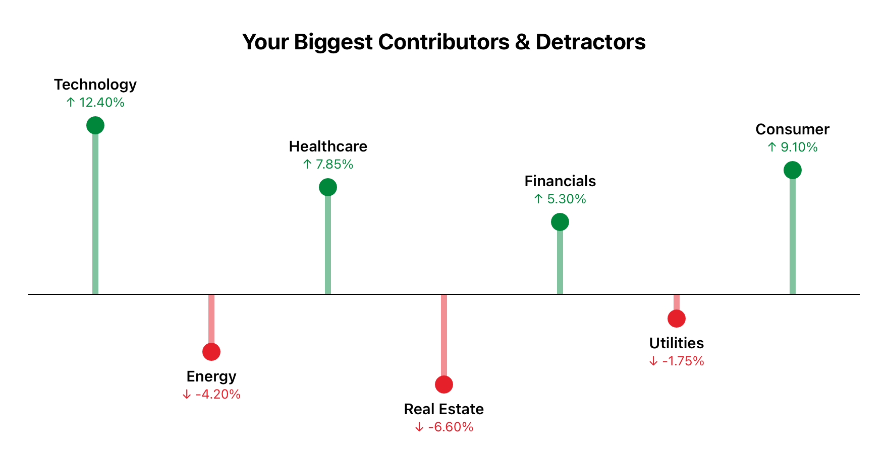
</picture>

<br>

[Installation](#installation) · [Quick Start](#quick-start) · [Customization](#customization) · [Example App](#example-application) · [Documentation](#documentation)

</div>

---

## Contents

<table>
<tr>
<td valign="top" width="33%">

- [Why ContributionChart?](#why-contributionchart)
- [Features](#features)
- [Preview Gallery](#preview-gallery)
- [Installation](#installation)
- [Requirements](#requirements)
- [Quick Start](#quick-start)
- [Understanding the Chart](#understanding-the-chart)
- [Customization](#customization)

</td>
<td valign="top" width="33%">

- [Responsive Layout](#responsive-layout)
- [Example Application](#example-application)
- [Architecture](#architecture)
- [Project Structure](#project-structure)
- [Testing](#testing)
- [Performance](#performance)
- [Accessibility](#accessibility)
- [Platform Support](#platform-support)

</td>
<td valign="top" width="33%">

- [Roadmap](#roadmap)
- [Contributing](#contributing)
- [Versioning](#versioning)
- [Changelog](#changelog)
- [Documentation](#documentation)
- [License](#license)
- [Support](#support)
- [Author](#author)

</td>
</tr>
</table>

---

## Why ContributionChart?

A chart like this looks simple until it meets real data and real screens. Drawing the circles is the easy part. The hard part is everything around them:

- **Labels collide** as soon as there are more than a few points, or the width shrinks.
- **Frames vary.** The same chart has to work in a `ScrollView`, a `List` row, a sheet, and a resizable Mac window. A `GeometryReader` collapses in a `ScrollView`, and can't report an ideal size.
- **Text grows.** Dynamic Type can make labels several times larger.
- **Data misbehaves.** `NaN`, infinity, and extreme ranges can quietly produce invalid geometry.
- **VoiceOver needs more than colour.** A green dot and a red dot mean nothing to someone who can't see them.

Rewriting this in every app means solving all of it again. ContributionChart solves it once, with tests, so you can write one line and get back to your app.

---

## Features

<table>
<tr>
<td width="50%" valign="top">

### ↔️ Responsive layout

Works in a `VStack`, `HStack`, `Grid`, `ScrollView`, `List`, sheet, or resizable window. When space runs short it drops labels first, then the title, and keeps the marks.

</td>
<td width="50%" valign="top">

### 📐 Honest scaling

One linear scale, so equal magnitudes are equally long on both sides of the baseline. Choose proportional, symmetric, or fixed.

</td>
</tr>
<tr>
<td valign="top">

### 🏷️ Labels that don't collide

Marks shrink as points get closer. The largest values keep their labels, and any label that would collide is left out.

</td>
<td valign="top">

### 🎨 Custom styling

Colours, fonts, sizes, and number formatting. The title, baseline, markers, stems, and labels are all optional.

</td>
</tr>
<tr>
<td valign="top">

### 📈 Axis and annotations

Add a value axis with tidy tick values, reference lines such as an average, shaded regions, and category ticks.

</td>
<td valign="top">

### ♿ Accessibility

VoiceOver hears a summary and each value with its direction in words. Includes an Audio Graph, Dynamic Type, right-to-left layout, and contrast-checked default colours.

</td>
</tr>
<tr>
<td valign="top">

### 🛡️ Handles bad input

`NaN`, infinities, repeated IDs, and invalid settings never produce invalid geometry. A fuzz test holds it to that.

</td>
<td valign="top">

### 📦 SPM ready

Swift 6 with strict concurrency, no third-party dependencies, and support for every Apple platform through Swift Package Manager.

</td>
</tr>
</table>

---

## Preview Gallery

Every image here is the real package, captured from the [example app](#example-application) on simulators or rendered by the test suite.

### See it adapt

The chart resizing live, switching scale modes, and changing style:

<p align="center">
  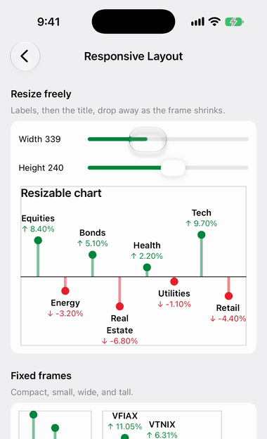
</p>

### Data shapes

<table>
<tr>
<td align="center" width="33%">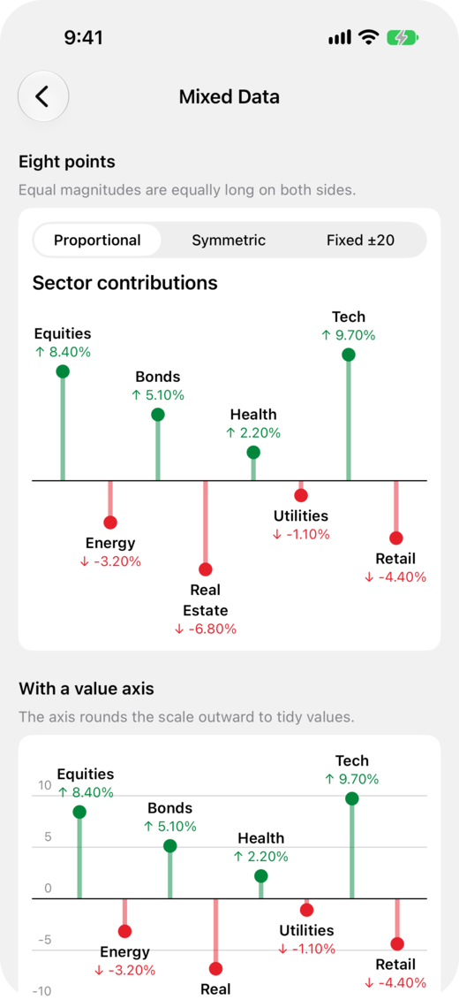<br><b>Mixed values</b><br>Contributors and detractors, with or without a value axis.</td>
<td align="center" width="33%">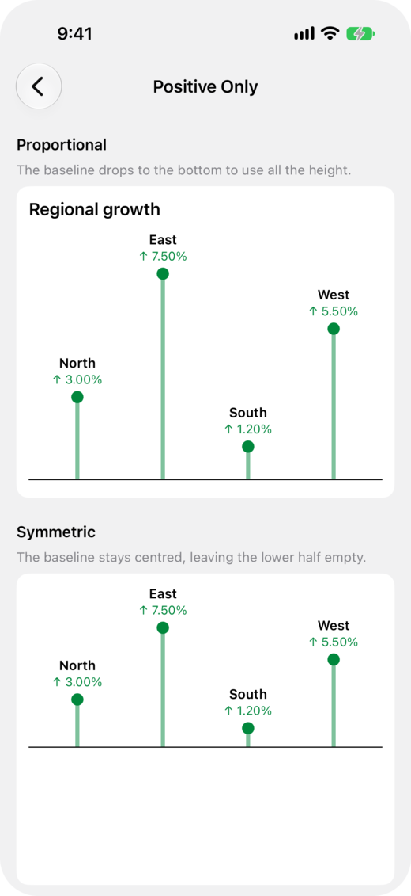<br><b>Positive only</b><br>The baseline moves down to use all the height.</td>
<td align="center" width="33%">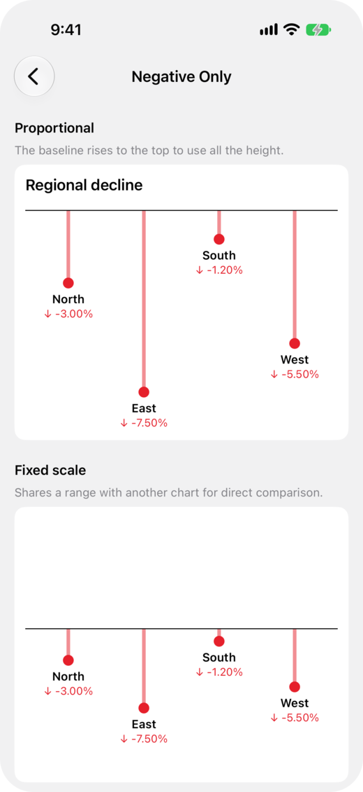<br><b>Negative only</b><br>The baseline moves up to use all the height.</td>
</tr>
</table>

### Styling and layout

<table>
<tr>
<td align="center" width="33%">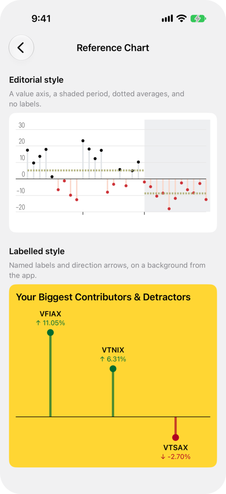<br><b>Two looks, one API</b><br>An editorial style, and labels on a coloured card.</td>
<td align="center" width="33%">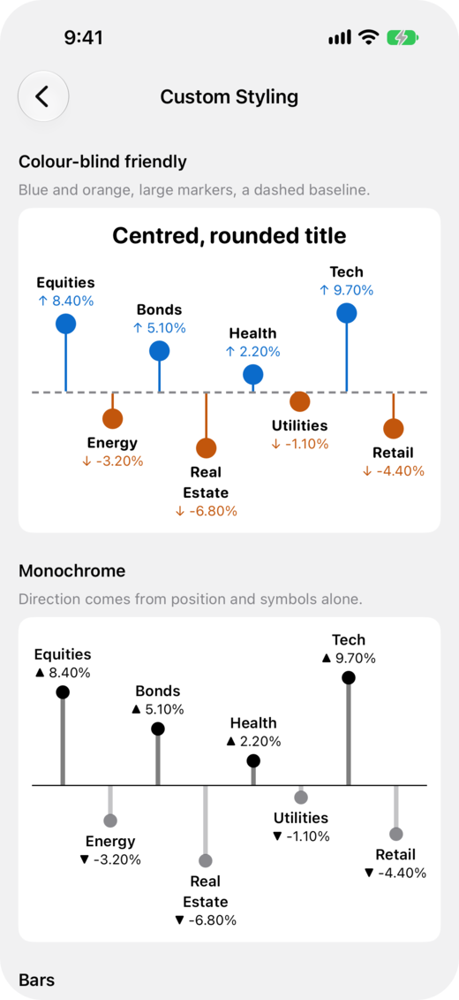<br><b>Custom styling</b><br>Colours, markers, fonts, and baselines.</td>
<td align="center" width="33%">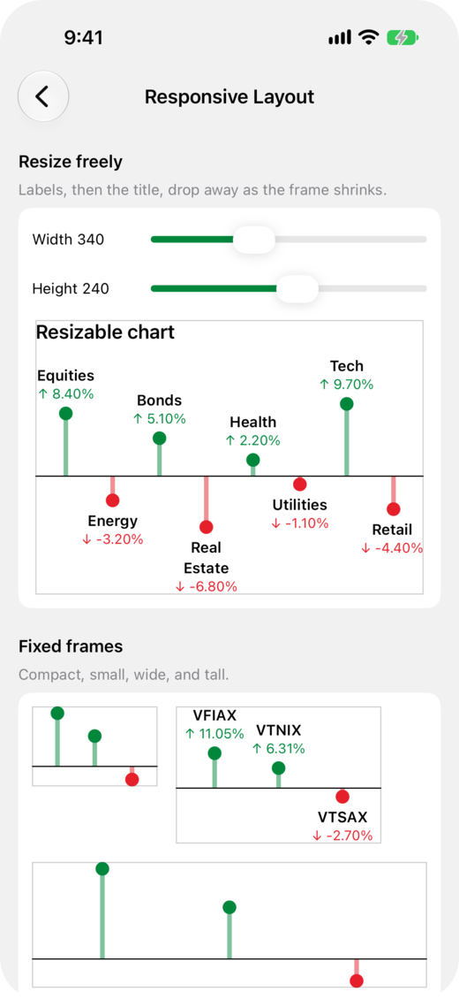<br><b>Responsive layouts</b><br>The same chart in compact, wide, and tall frames.</td>
</tr>
</table>

### Appearance and accessibility

<table>
<tr>
<td align="center" width="33%">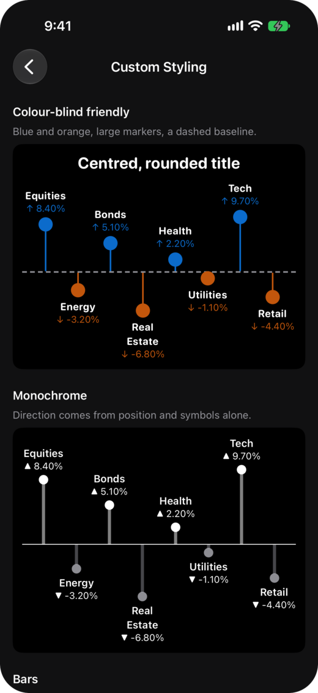<br><b>Dark mode</b><br>Text follows the appearance, and the default mark colours are checked against black.</td>
<td align="center" width="33%">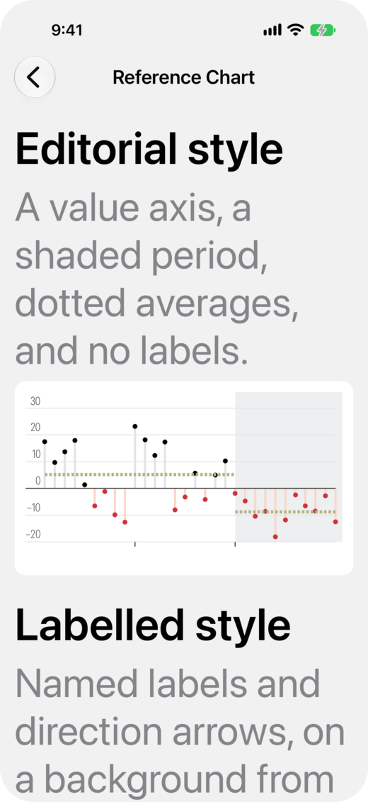<br><b>Dynamic Type</b><br>At the largest accessibility text size.</td>
<td align="center" width="33%">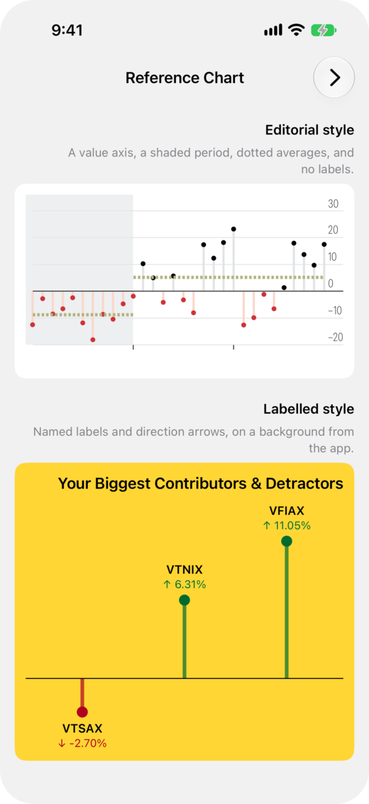<br><b>Right to left</b><br>The whole chart mirrors, marks and labels together.</td>
</tr>
</table>

### iPad and Mac

<table>
<tr>
<td align="center" width="50%">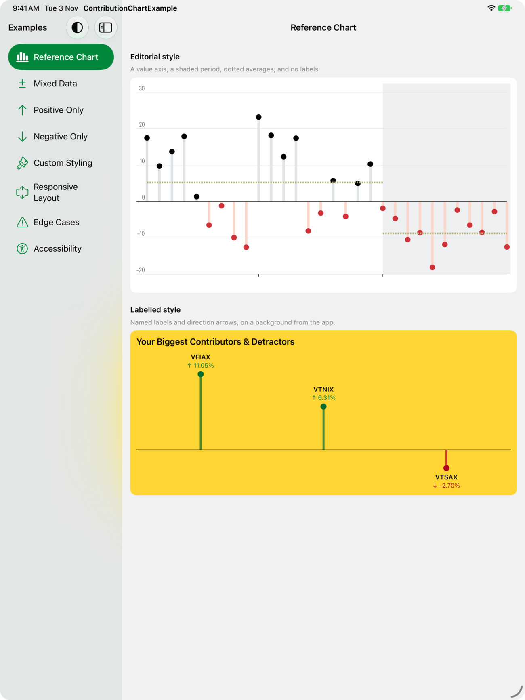<br><b>iPad</b></td>
<td align="center" width="50%">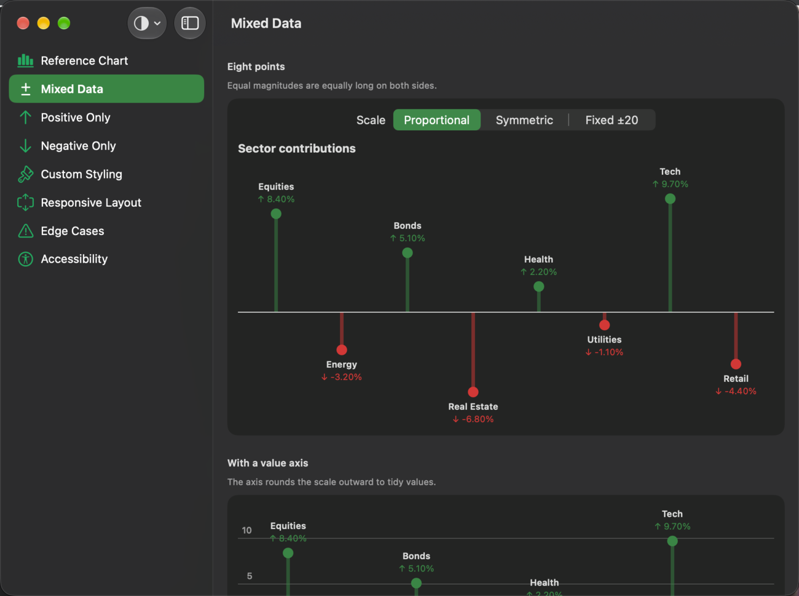<br><b>Mac</b></td>
</tr>
</table>

---

## Installation

### Xcode

1. Choose **File > Add Package Dependencies**.
2. Enter the repository URL:

   ```text
   https://github.com/tahirwaseempk90/ContributionChartKit
   ```

3. Choose a version rule. **Up to Next Major Version** from `1.0.0` is the usual choice.
4. Add the **ContributionChart** library to your app target.

### Package.swift

```swift
dependencies: [
    .package(url: "https://github.com/tahirwaseempk90/ContributionChartKit.git", from: "1.0.0")
],
targets: [
    .target(
        name: "MyFeature",
        dependencies: [.product(name: "ContributionChart", package: "ContributionChartKit")]
    )
]
```

> [!NOTE]
> Two names are involved. `package:` is the last part of the URL, `ContributionChartKit`, because that's how Swift Package Manager identifies a dependency. `name:` is the library, `ContributionChart`, which is also what you import.

### Local development

To work on the package and your app together, clone this repository and add it with **File > Add Package Dependencies > Add Local**. Or, in `Package.swift`:

```swift
.package(path: "../ContributionChartKit")
```

See the [integration guide](Documentation/Integration.md) for versioning and how to resolve name conflicts.

---

## Requirements

| | Minimum |
|---|---|
| **iOS, iPadOS, Mac Catalyst** | 16 |
| **macOS** | 13 |
| **tvOS** | 16 |
| **watchOS** | 9 |
| **visionOS** | 1 |
| **Swift tools** | 6.0 |
| **Xcode** | 16 |
| **Dependencies** | None |

It has been built and tested with Xcode 16.2 (Swift 6.0), 16.4 (Swift 6.1), 26.6 (Swift 6.3), and 27.2 (Swift 6.4). See [Platform Support](#platform-support) for the OS versions.

---

## Quick Start

```swift
import ContributionChart
import SwiftUI

struct PortfolioView: View {
    private let points: [ChartDataPoint] = [
        .init(title: "VFIAX", value: 11.05),
        .init(title: "VTNIX", value: 6.31),
        .init(title: "VTSAX", value: -2.70)
    ]

    var body: some View {
        ContributionChart(points: points, title: "Your Biggest Contributors & Detractors")
            .frame(maxWidth: .infinity)
            .frame(height: 260)
    }
}
```

To plot your own types, map them to `ChartDataPoint`:

```swift
let points = holdings.map {
    ChartDataPoint(id: $0.ticker, title: $0.ticker, value: $0.returnPercent)
}
```

> [!TIP]
> Pass an `id` when titles can repeat. Otherwise the title is used as the identifier, which keeps identity stable when your data is rebuilt.

---

## Understanding the Chart

```text
   VFIAX               name
 ↑ 11.05%              direction and value
    ●                  marker: its distance from the baseline shows the value
    │                  stem: connects the marker to the baseline
────┼─────────┼────    zero baseline
              │
              ●
            VTSAX
          ↓ -2.70%
```

| Part | What it does |
|---|---|
| **Zero baseline** | The reference line. It sits wherever zero falls on the scale. |
| **Contributors** | Positive values, plotted above the baseline. Green by default. |
| **Detractors** | Negative values, plotted below the baseline. Red by default. |
| **Zero values** | Drawn on the baseline in grey, with no stem. |
| **Markers** | Circles at each value. They shrink as points get closer. |
| **Stems** | Connect each marker to the baseline. |
| **Labels** | The name and value. Positive labels sit above the marker, and negative labels below it. |

### How the scale is calculated

All modes use one linear scale that includes zero, so equal magnitudes are equally long on both sides.

| Mode | Behaviour | Use it when |
|---|---|---|
| `.proportional` (default) | Fits the data, and the baseline moves to wherever zero falls | You want to use all the available height |
| `.symmetric` | Extends equally both ways, keeping the baseline centred | The middle of the chart should always mean zero |
| `.fixed(lower:upper:)` | Uses exactly this range | Several charts must share a scale |

Non-finite values are left out, and the spoken summary reports how many. Very small values stay on their own side of the baseline instead of looking like zero. Set `style.stem.minimumLength = 0` to draw strictly to scale.

---

## Customization

Start from a default configuration and change only what you need:

```swift
var configuration = ChartConfiguration()
configuration.scale = .symmetric
configuration.style.positive = .init(color: .blue)
configuration.style.negative = .init(color: .orange)
configuration.style.marker.diameter = 18
configuration.style.stem.width = 2
configuration.style.baseline = ChartLineStyle(color: .secondary, thickness: 2, dash: [6, 4])
configuration.style.annotation.titleFont = .subheadline.weight(.bold)
configuration.style.annotation.valueFont = .footnote
configuration.style.header.font = .title2.bold()
configuration.style.header.alignment = .center
configuration.layout.insets = EdgeInsets(top: 8, leading: 12, bottom: 8, trailing: 12)
configuration.valueFormatter = .number(fractionDigits: 0...1)

ContributionChart(points: points, title: "Quarterly results", configuration: configuration)
    .frame(height: 300)
```

The chart has no background of its own, so it fits into your design. Add one with an ordinary SwiftUI modifier:

```swift
ContributionChart(points: points)
    .frame(height: 260)
    .padding()
    .background(.yellow, in: RoundedRectangle(cornerRadius: 16))
```

### Optional elements

```swift
configuration.style.marker.isVisible = false        // Stems only, for a bar chart
configuration.style.stem.isVisible = false          // Markers only
configuration.style.baseline.isVisible = false
configuration.style.annotation.isVisible = false    // VoiceOver can still reach every point
```

### Formatting

```swift
configuration.valueFormatter = .percent(fractionDigits: 1)      // 6.31 → "6.3%"
configuration.valueFormatter = .number(fractionDigits: 0...2)   // 6.31 → "6.31"
configuration.valueFormatter = ChartValueFormatter { value in
    value.formatted(.currency(code: "USD"))
}
```

`percent` takes values that are already percentages. Built-in formatters follow the user's locale, never round a real change down to `0.00%`, and switch to compact or scientific notation for very large values.

### Axis and annotations

```swift
configuration.valueAxis = ChartValueAxis()      // Gridlines and tick labels
configuration.referenceLines = [
    ChartReferenceLine(value: 5.2, style: ChartLineStyle(color: .purple, dash: [3, 2]))
]
configuration.regions = [ChartRegion(points: 4...7, color: .gray.opacity(0.1))]
configuration.categoryTicks = ChartCategoryTicks(points: [4])
```

### Empty state

```swift
ContributionChart(points: points) {
    Label("Add a holding to get started", systemImage: "plus.circle")
}
```

### Configuration reference

`ChartConfiguration` holds everything, and each part is optional:

| Property | Description | Default |
|---|---|---|
| `scale` | How values map to vertical positions | `.proportional` |
| `style` | Colours, sizes, and fonts | See below |
| `layout` | Spacing and sizing | See below |
| `valueFormatter` | How values are written on labels and read by VoiceOver | `.percent()`, which shows 2 decimal places |
| `valueAxis` | Gridlines and tick labels | `nil`, hidden |
| `referenceLines` | Lines at values of interest | None |
| `regions` | Background bands | None |
| `categoryTicks` | Tick marks below the plot | `nil`, hidden |
| `accessibility` | VoiceOver wording and identifiers | See below |

<details>
<summary><b>Colours</b>: <code>style.positive</code>, <code>style.negative</code>, <code>style.zero</code></summary>

<br>

| Property | Description | Default |
|---|---|---|
| `markerColor` | The marker fill | Green `#00873C`, red `#E5202B`, grey `#767676` |
| `stemColor` | The stem, before its opacity is applied | Same as the marker |
| `valueColor` | The value text | Same as the marker |

Use `.init(color:)` to set all three at once. The defaults keep at least 4.5:1 contrast on both pure white and pure black.

</details>

<details>
<summary><b>Markers</b>: <code>style.marker</code></summary>

<br>

| Property | Description | Default |
|---|---|---|
| `isVisible` | Whether markers are drawn | `true` |
| `diameter` | The diameter in points, when there is room | `12` |
| `minimumDiameter` | The smallest size in dense charts | `3` |
| `maximumSpacingFraction` | The largest share of the distance between points a marker may use | `0.7` |

</details>

<details>
<summary><b>Stems</b>: <code>style.stem</code></summary>

<br>

| Property | Description | Default |
|---|---|---|
| `isVisible` | Whether stems are drawn | `true` |
| `width` | The width in points, which shrinks in step with markers | `4` |
| `opacity` | Applied to the stem colour | `0.5` |
| `minimumLength` | The smallest distance from a non-zero value to the baseline | `6` |

</details>

<details>
<summary><b>Baseline and lines</b>: <code>style.baseline</code>, <code>ChartLineStyle</code></summary>

<br>

| Property | Description | Default |
|---|---|---|
| `isVisible` | Whether the line is drawn | `true` |
| `color` | The line colour | `.primary` for the baseline |
| `thickness` | The thickness in points | `1` |
| `dash` | Alternating dash and gap lengths | Solid |

</details>

<details>
<summary><b>Labels</b>: <code>style.annotation</code></summary>

<br>

| Property | Description | Default |
|---|---|---|
| `isVisible` | Whether labels are drawn | `true` |
| `titleFont` | The name's font | `.footnote.weight(.semibold)` |
| `titleColor` | The name's colour | `.primary` |
| `titleLineLimit` | Lines before a long name truncates | `2` |
| `valueFont` | The value's font | `.caption` |
| `lineSpacing` | Space between the name and the value | `1` |
| `markerSpacing` | Space between the marker and the label | `4` |
| `minimumWidth` | The narrowest width a label is offered in dense charts | `56` |
| `collisionPadding` | Clear space kept around a label | `2` |
| `directionIndicators` | The symbols before a value | `↑`, `↓`, none |

</details>

<details>
<summary><b>Title</b>: <code>style.header</code></summary>

<br>

| Property | Description | Default |
|---|---|---|
| `font` | The title's font | `.headline` |
| `color` | The title's colour | `.primary` |
| `alignment` | The title's alignment | `.leading` |
| `spacing` | Space between the title and the plot | `12` |

</details>

<details>
<summary><b>Layout</b>: <code>layout</code></summary>

<br>

| Property | Description | Default |
|---|---|---|
| `pointDistribution` | `.slots` centres each point in an equal slot. `.edgeToEdge` puts the end points at the plot's edges. | `.slots` |
| `insets` | Space between the frame and the content | Zero |
| `idealWidth` | The width when the parent leaves it open | `320` |
| `idealPlotHeight` | The plot height when the parent leaves it open | `140` |
| `minimumPointSpacing` | Width per point when the parent leaves it open | `8` |
| `minimumPlotHeight` | Below this, the chart gives up labels, then the title, then axis labels | `32` |

</details>

<details>
<summary><b>Value axis</b>: <code>ChartValueAxis</code></summary>

<br>

| Property | Description | Default |
|---|---|---|
| `desiredTickCount` | Roughly how many ticks to aim for | `6` |
| `gridline` | The gridline style | `.secondary` at 35% |
| `showsLabels` | Whether tick labels are shown | `true` |
| `labelFont` | The tick label font | `.caption2` |
| `labelColor` | The tick label colour | `.secondary` |
| `labelFormatter` | How tick values are written. `nil` shows the digits the spacing needs. | `nil` |
| `labelSpacing` | Space between a label and its gridline | `2` |
| `labelTrailingSpacing` | Space between the labels and the first point | `4` |

</details>

<details>
<summary><b>Annotations</b>: <code>ChartReferenceLine</code>, <code>ChartRegion</code>, <code>ChartCategoryTicks</code></summary>

<br>

| Type | Property | Description | Default |
|---|---|---|---|
| `ChartReferenceLine` | `value` | Where the line is drawn | Required |
| | `points` | The indices it spans | `nil`, the whole chart |
| | `style` | The line's appearance | Required |
| `ChartRegion` | `points` | The indices it covers | Required |
| | `color` | The fill colour | Required |
| `ChartCategoryTicks` | `points` | The indices that get a tick | Required |
| | `length` | The tick length in points | `5` |
| | `style` | The tick's appearance | `.primary` |

</details>

<details>
<summary><b>Accessibility</b>: <code>accessibility</code></summary>

<br>

| Property | Description | Default |
|---|---|---|
| `identifier` | The chart's identifier, which child elements add a suffix to | `"contribution-chart"` |
| `label` | The chart's spoken name | The title, then `"Contribution chart"` |
| `summary` | A closure that replaces the description of the contents | `nil`, English wording |
| `pointValue` | A closure that replaces a point's spoken value | `nil`, English wording |
| `isAudioGraphEnabled` | Whether to offer the Audio Graph | `true` |
| `categoryAxisTitle` | The Audio Graph's horizontal axis name | `"Items"` |
| `valueAxisTitle` | The Audio Graph's vertical axis name | `"Value"` |

</details>

More recipes are in the [customization guide](Documentation/Customization.md), and every public type is in the [API reference](Documentation/API.md).

---

## Responsive Layout

The parent decides the size, and the chart adapts its layout to fit:

```swift
// A compact card.
ContributionChart(points: points)
    .frame(height: 180)

// Full width with a fixed height.
ContributionChart(points: points)
    .frame(maxWidth: .infinity)
    .frame(height: 300)

// A fixed shape.
ContributionChart(points: points)
    .aspectRatio(16 / 9, contentMode: .fit)

// In a ScrollView or List, with no frame: it chooses a height that grows with Dynamic Type.
ScrollView {
    ContributionChart(points: points)
}

// A dense chart that scrolls: it chooses a width that gives each point room.
ScrollView(.horizontal) {
    ContributionChart(points: manyPoints)
        .frame(height: 240)
}
```

| When | What the chart does |
|---|---|
| **Height runs short** | Drops labels, then the title, then axis labels. Marks are always kept, and VoiceOver can still reach every value. |
| **Points get close** | Shrinks marks in proportion, and keeps the labels of the largest values. |
| **The parent leaves a size open** | Uses an ideal size, and never grows without limit. |
| **Right-to-left layout** | Mirrors everything together. |
| **The display scale changes** | Aligns lines to device pixels, so they stay crisp at 1x, 2x, and 3x. |

The chart has no device-specific code. It responds only to its frame, so a compact iPhone card, a wide iPad layout, and a resizable Mac window all run the same logic. UI tests ran on small and large iPhone and iPad simulators, including rotation and live resizing, and snapshot tests cover frames from 44 × 44 up to 900 × 420.

> [!TIP]
> To keep labels in a tight space, lower `layout.minimumPlotHeight`.

---

## Example Application

[`Example/`](Example/README.md) is a complete SwiftUI app. It imports the package through a local Swift Package reference, so it builds against the code in this repository, and it contains no chart code of its own.

```sh
git clone https://github.com/tahirwaseempk90/ContributionChartKit.git
open ContributionChartKit/Example/ContributionChartExample.xcodeproj
```

Choose the `ContributionChartExample` scheme and an iOS or visionOS simulator, or **My Mac**, then run. No signing setup is needed.

<table>
<tr>
<td width="32%" valign="top">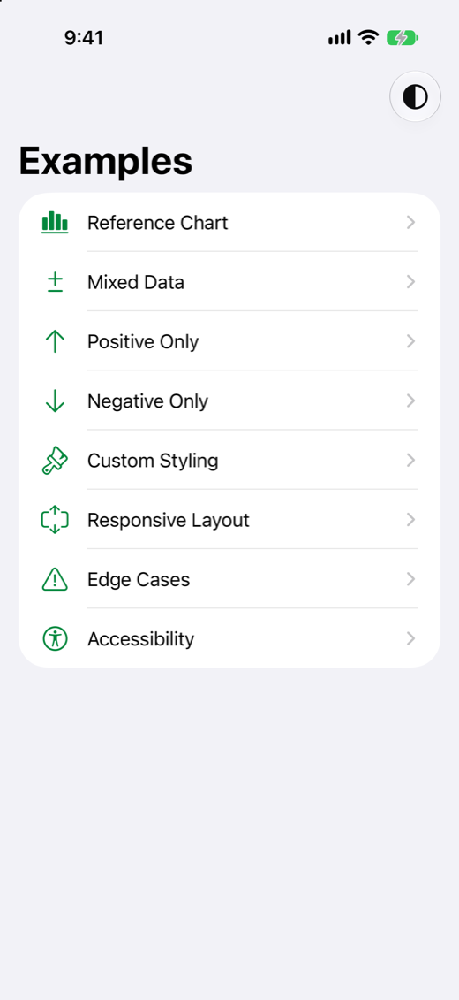</td>
<td valign="top">

- **Reference Chart.** Two contrasting looks: an editorial style with a value axis, and a labelled style on a yellow card.
- **Mixed Data.** Positive and negative values, with a picker for each scale mode.
- **Positive Only.** All points above the baseline.
- **Negative Only.** All points below the baseline.
- **Custom Styling.** Seven configurations: colours, markers, bars, formatting, and reference lines.
- **Responsive Layout.** Sliders to resize a chart, plus fixed frames, `HStack`, `Grid`, `List`, a sheet, and horizontal scrolling.
- **Edge Cases.** Empty, one point, all zero, extreme values, long names, invalid values, duplicates, and up to 1,000 points.
- **Accessibility.** Dynamic Type, right-to-left layout, and custom VoiceOver wording.

</td>
</tr>
</table>

---

## Architecture

The chart turns data into positions in one pure calculation, then draws the result. Most of what's worth testing lives in that calculation, so it can be tested without rendering anything.

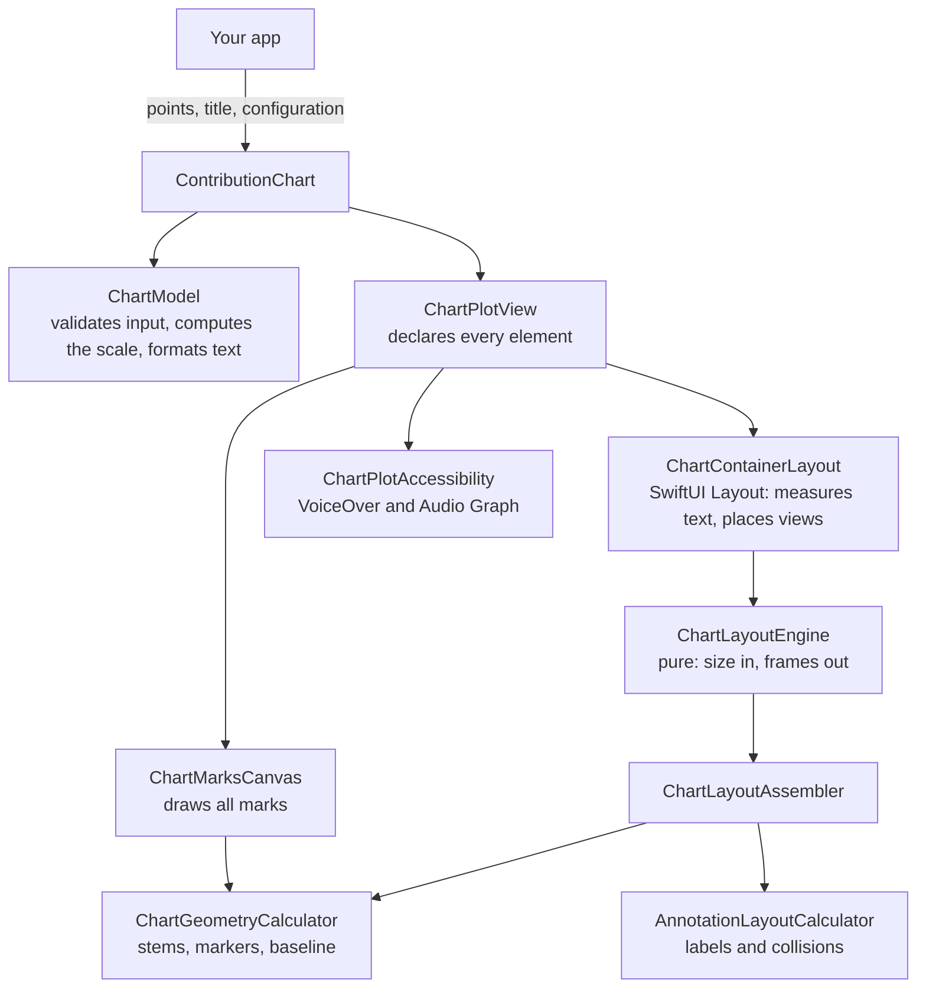

| Decision | Why |
|---|---|
| **A custom `Layout`, not `GeometryReader`** | It receives the parent's real proposal, so it can answer an open dimension with an ideal size instead of collapsing. |
| **One `Canvas` for marks, views for text** | A thousand points don't become thousands of views, and text stays visible to VoiceOver. |
| **Geometry is a pure function of size** | The canvas and the layout always agree, with no shared state between them. |
| **Separate VoiceOver elements** | A point stays reachable when its label doesn't fit, and direction is spoken in words. |

Each concern stays in its own layer:

- **Public API.** The view, and plain value types that describe a chart. Everything below this layer is internal, so it can change without breaking your code.
- **Model.** `ChartModel` checks the data, chooses the scale, and formats text. It knows nothing about size.
- **Geometry.** Pure functions from a size to a frame for every element. They draw nothing.
- **Rendering.** Connects that geometry to SwiftUI, and draws it.
- **Accessibility.** A separate layer of transparent elements, independent of what's visible.

Read the [architecture guide](Documentation/Architecture.md) for the full reasoning, including the options that were rejected.

---

## Project Structure

```text
ContributionChartKit/
├── Package.swift
├── Sources/ContributionChart/
│   ├── Public/           The API: chart, data point, configuration, style, formatter
│   ├── Core/             Validated data, scale, metrics, layout result
│   ├── Layout/           Layout engine, vertical plan, geometry, label placement
│   ├── Rendering/        Layout adapter, Canvas renderer, view assembly
│   ├── Components/       Header, labels, empty state
│   ├── Accessibility/    Spoken text, VoiceOver elements, Audio Graph
│   └── Utilities/        Number formatting, pixel alignment
├── Tests/ContributionChartTests/   Unit, rendering, snapshot, fuzz, and performance tests
├── Example/                        The example app and its UI tests
├── Documentation/                  Guides and images
├── Scripts/                        Coverage and screenshot tools
└── .github/                        CI, and issue and pull request templates
```

---

## Testing

```sh
swift test                # Unit, rendering, snapshot, and performance tests on macOS
Scripts/coverage.sh 99    # The same, with a coverage report and a minimum
```

```sh
# The example app's UI tests.
xcodebuild test -project Example/ContributionChartExample.xcodeproj \
  -scheme ContributionChartExample \
  -destination 'platform=iOS Simulator,name=iPhone 17'
```

The package has 429 tests, and the example app has 59 UI tests.

| Tests | What they cover |
|---|---|
| **Unit tests** | Scaling, layout, formatting, validation, and the wording VoiceOver reads |
| **Edge cases** | Empty data, one point, all zero, extreme and uneven values, long names, and repeated IDs |
| **Fuzz tests** | 4,500 seeded combinations of hostile input, asserting that all geometry is finite and in bounds |
| **Rendering tests** | The real view, examined pixel by pixel, including an exact right-to-left mirror check |
| **Snapshot tests** | Device-sized frames, light and dark, dense data, and Dynamic Type, with no snapshot library |
| **UI tests** | Launch, navigation, rotation, sheets, list rows, and the accessibility tree that VoiceOver reads |

**Measured coverage** of the package's sources, from `Scripts/coverage.sh`:

| Lines | Functions | Regions |
|---|---|---|
| 100% (1944/1944) | 100% (324/324) | 99.86% (698/699) |

Coverage shows which lines ran, not that they're right. [CI](.github/workflows/ci.yml) runs on pushes to `main` and on pull requests. It builds with warnings as errors, runs the tests, and fails if line coverage falls below 99%. A separate [compatibility workflow](.github/workflows/compatibility.yml) runs them on older systems, back to Swift 6.0 and iOS 16.4. See the [testing guide](Documentation/Testing.md) for the details, including how to record snapshots.

---

## Performance

Measured in a release build on an Apple Silicon Mac, for a 393 × 300 chart. Times are in milliseconds, and "Render" is a complete offscreen render, including all text.

| Points | Build model | Layout | Render | Labels shown |
|---:|---:|---:|---:|---:|
| 3 | 0.01 | < 0.01 | 0.92 | 3 |
| 10 | 0.01 | < 0.01 | 1.71 | 6 |
| 50 | 0.07 | 0.01 | 6.81 | 11 |
| 100 | 0.14 | 0.02 | 13.45 | 11 |
| 500 | 0.20 | 0.03 | 13.56 | 9 |
| 1,000 | 0.25 | 0.04 | 12.88 | 10 |

Time stops growing past about 100 points, because text is only created for the 100 largest values. Measure on your own target devices if you're rendering many charts at once.

---

## Accessibility

- **VoiceOver summary.** The chart is announced as a heading, followed by what it contains: *"3 data points: 2 contributors and 1 detractor. Largest contributor: VFIAX, 11.05%. Largest detractor: VTSAX, -2.70%."*
- **Every point is reachable,** including when its label doesn't fit: *"VFIAX, Positive, 11.05%"*.
- **Grouped and in order.** The chart is one container, read as its summary and then each point in display order. Its visible text is hidden, so nothing is read twice.
- **Direction isn't left to colour.** It's shown by position and arrows, and spoken in words.
- **Audio Graph.** VoiceOver users can hear the data's shape and browse every value in a table.
- **Dynamic Type.** Text styles scale, and a chart with no fixed height grows to fit.
- **Large datasets stay usable.** The 100 largest values get their own elements, and all values are in the Audio Graph.
- **Contrast.** The default marker colours keep at least 4.5:1 on both white and black, which a test verifies.
- **All wording can be replaced,** which is also how to localise it. The defaults are in English.

The element order and wording are tested against the real accessibility tree. The chart hasn't yet been tried by hand with VoiceOver.

---

## Platform Support

| Platform | Declared minimum | Oldest version tested | Package tests run on | UI tests run on |
|---|---|---|---|---|
| **iOS** | 16 | 16.4 | 16.4, 17.0, 18.6, 26.5, 27.2 | 17.0, 18.6, 26.5, 27.2 |
| **iPadOS** | 16 | 27.2 | Same build as iOS | 27.2 |
| **macOS** | 13 | 14 | 14, 15, 26, 27.2 | 27.2 |
| **Mac Catalyst** | 16 | macOS 14 | macOS 14, 27.2 | None |
| **visionOS** | 1 | 1.0 | 1.0, 27.2 | None |
| **tvOS** | 16 | 16.4 | 16.4, 17.0, 27.2 | None |
| **watchOS** | 9 | 9.4 | 9.4, 10.0, 27.2 | None |

> [!IMPORTANT]
> Testing has been on simulators and Macs, not physical devices. macOS 13 is the one declared minimum that hasn't been run, because GitHub's runners no longer offer it. Snapshot tests only compare images on OS 27. See [Platform Support](Documentation/PlatformSupport.md) for the details and known limitations.

---

## Roadmap

These are ideas under consideration, with no dates. **None of them is implemented yet.**

- [ ] Selecting a point, with tap and hover callbacks
- [ ] Custom views for labels
- [ ] Animated transitions between datasets
- [ ] A logarithmic scale for very uneven data
- [ ] Describing reference lines and regions to VoiceOver
- [ ] Bundled translations of the default VoiceOver wording

---

## Contributing

Contributions are welcome. [Fork the repository](https://github.com/tahirwaseempk90/ContributionChartKit/fork), then:

```sh
git clone https://github.com/YOUR_USERNAME/ContributionChartKit.git
cd ContributionChartKit
git checkout -b my-change
swift build
swift test
swiftlint lint --strict
```

Push your branch and open a pull request against `main`. In short, keep the public API small, keep layout code pure, add no dependencies, and give every behaviour change a test. Read [CONTRIBUTING.md](CONTRIBUTING.md) for the full expectations and how to record snapshots. This project follows a [code of conduct](CODE_OF_CONDUCT.md).

---

## Versioning

The package follows [Semantic Versioning](https://semver.org):

| Change | Version | For example |
|---|---|---|
| **Major** | `2.0.0` | Removing public API, or raising a minimum platform |
| **Minor** | `1.1.0` | A new configuration option with a default value |
| **Patch** | `1.0.1` | A fix that doesn't change the API |

---

## Changelog

Every release is recorded in [CHANGELOG.md](CHANGELOG.md).

---

## Documentation

| Guide | What's in it |
|---|---|
| [Architecture](Documentation/Architecture.md) | How it works, and why |
| [API Reference](Documentation/API.md) | Every public type, with defaults |
| [Integration](Documentation/Integration.md) | Adding the package, versioning, and name conflicts |
| [Customization](Documentation/Customization.md) | Recipes for colours, fonts, formatting, and sizing |
| [Testing](Documentation/Testing.md) | Running the tests, coverage, and performance |
| [Platform Support](Documentation/PlatformSupport.md) | What is tested where, and known limitations |

The public API also has documentation comments and a DocC catalog. In Xcode, choose **Product > Build Documentation**.

---

## License

ContributionChart is available under the [MIT license](LICENSE).

## Acknowledgements

Built with [SwiftUI](https://developer.apple.com/xcode/swiftui/). The example project is generated with [XcodeGen](https://github.com/yonaskolb/XcodeGen), and the code is checked with [SwiftLint](https://github.com/realm/SwiftLint).

## Support

Found a bug or have an idea? [Open an issue](https://github.com/tahirwaseempk90/ContributionChartKit/issues/new/choose). To report a security problem, follow the [security policy](SECURITY.md).

## Author

Created and maintained by [Tahir Waseem](https://github.com/tahirwaseempk90).

<div align="center">
<br>

**If ContributionChart is useful to you, a ⭐ helps others find it.**

</div>
